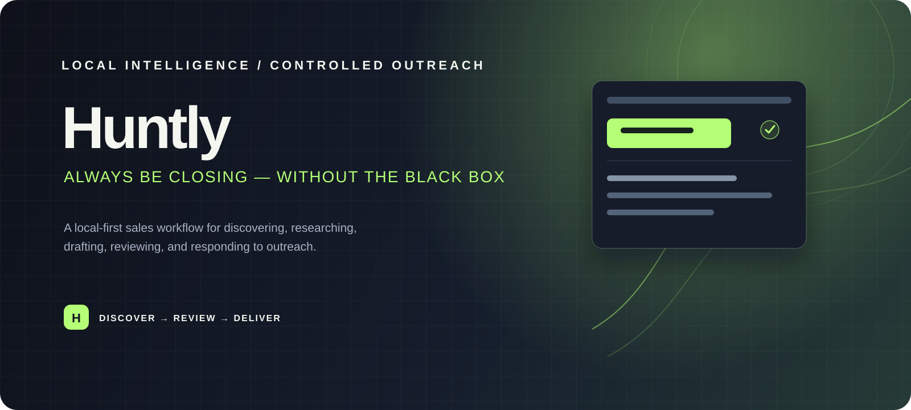

<p align="center">
  
</p>

<p align="center">
  <strong>A local-first sales workflow for thoughtful, reviewable outreach.</strong><br>
  Discover the right businesses, understand their context, write a useful message,<br>
  and keep a human in control before anything leaves the outbox.
</p>

<p align="center">
  
  
  
  
  
  
</p>

<p align="center">
  <a href="#quick-start">Quick start</a> ·
  <a href="#how-huntly-works">How it works</a> ·
  <a href="#configuration">Configuration</a> ·
  <a href="#safety-model">Safety model</a>
</p>

## The idea

Huntly is a local sales-workflow engine for independent operators and small
teams. It turns a defined offer and audience into a visible pipeline:
business discovery, website research, qualification, contact verification,
message drafting, approval, delivery, and reply handling.

The important part is not “send more emails.” The important part is keeping the
whole process understandable. Huntly stores its state locally, shows its work
in a browser dashboard, estimates paid discovery before it runs, and stops
outbound messages at a human approval gate.

<details>
<summary><strong>What makes Huntly different?</strong></summary>

- **Local-first:** configuration, prompts, observations, prospects, and
  outbox state live in the project directory.
- **Inspectable:** every stage leaves durable records in SQLite and appears in
  the dashboard or activity log.
- **Human-gated:** approval is required before native email delivery.
- **Provider-explicit:** Huntly does not silently switch to another AI or
  delivery provider when the selected one fails.
- **Operationally bounded:** quiet hours, daily send limits, budget checks,
  bounce protection, and a manual sending kill switch are enforced before
  delivery.
</details>

## Quick start

The fastest path is to run Huntly locally in a Python virtual environment,
complete the setup wizard, and open the dashboard.

### 1. Install Huntly

```bash
git clone https://github.com/atharhive/Huntly.git
cd Huntly

python3 -m venv .venv
source .venv/bin/activate
python -m pip install -e .
```

<details>
<summary><strong>Windows activation</strong></summary>

```powershell
py -3 -m venv .venv
.\.venv\Scripts\Activate.ps1
python -m pip install -e .
```
</details>

### 2. Create local environment variables

```bash
cp .env.example .env
```

Keep `.env` private. It is for credentials only and should never be committed.
The committed [`huntly.yaml`](huntly.yaml) describes the operator, offer,
audience, channels, limits, and AI provider.

<details>
<summary><strong>Minimum useful setup</strong></summary>

For an AI-assisted workflow, configure:

1. `GEMINI_API_KEY` if using Gemini, or the selected Claude/Codex login.
2. One email provider: Gmail, SMTP, or an existing Instantly setup.
3. One discovery provider such as Serper or SerpApi.
4. One verifier such as Reoon if you want contacts to become deliverable.

The exact provider names must match `brain.provider` and
`channels.email.provider` in `huntly.yaml`.
</details>

### 3. Run the setup wizard

```bash
huntly setup
```

The browser setup flow is the recommended experience. If you need a terminal
flow instead:

```bash
huntly setup --terminal
```

For Gmail OAuth, configure a Google Cloud OAuth desktop application, enable
the Gmail API, add the client values to `.env`, then run:

```bash
huntly gmail auth
```

### 4. Open the dashboard

```bash
huntly dashboard
```

Open <http://127.0.0.1:5555>. The dashboard is local to the machine running
Huntly and is the main place to inspect companies, contacts, signals,
campaigns, conversations, usage, logs, and the Outbox.

### 5. Start a controlled run

```bash
huntly status
huntly signals
huntly discover --estimate
huntly run
```

Discovery estimates are safe to run: they show the planned queries and
estimated spend without calling the paid provider. Run the real discovery only
after reviewing the estimate.

## How Huntly works

Huntly runs a deterministic heartbeat. Each cycle checks the operating
constraints first, then performs the smallest useful next action. AI helps with
interpretation and composition; it does not get to bypass the safety boundary.

```text
DISCOVER → PROFILE → QUALIFY → VERIFY → WRITE → REVIEW → SEND → RESPOND
```

<details>
<summary><strong>1. Discover</strong></summary>

Search providers find businesses that match the industries and geography in
your ICP. Huntly records the source, query, rank, and estimated cost. Available
providers depend on the credentials configured in `.env`.

```bash
huntly discover --providers
huntly discover --provider serpapi --estimate
huntly discover --provider serpapi --limit 10 --max-spend 1
```
</details>

<details>
<summary><strong>2. Profile and qualify</strong></summary>

Huntly reads company-owned pages, records observations, and applies the
signals you confirm in the dashboard. It does not treat every search result as
a qualified contact. Directories, aggregators, and unusable profile rows are
filtered from the deliverable prospect pool.

```bash
huntly profile
```
</details>

<details>
<summary><strong>3. Verify contacts</strong></summary>

Huntly prefers publicly published business inboxes and verified addresses. A
pattern guess is never treated as deliverable. When a verifier reports a
catch-all or risky result, it stays subject to your configuration and approval
rules.
</details>

<details>
<summary><strong>4. Write drafts</strong></summary>

The writer uses your product knowledge, offer, audience, and recorded company
observations to create a campaign. It refuses to create a real deliverable
draft for an unverified or otherwise ineligible address.

With native Gmail or SMTP, Huntly continues prospecting and drafting until its
configured real-draft target is reached, then returns to its normal heartbeat
schedule.
</details>

<details>
<summary><strong>5. Review and send</strong></summary>

Every native outbound message enters the Outbox. With
`require_approval: true`, nothing sends until you approve it in the dashboard
or CLI. Approved messages are still checked against quiet hours, daily limits,
reply state, bounce rate, and the sending kill switch.

```bash
huntly outbox
huntly outbox --approve <id>
huntly outbox --approve-all
huntly outbox --reject <id>
```
</details>

<details>
<summary><strong>6. Handle replies</strong></summary>

The handler classifies incoming replies and records conversation state. Replies,
bounces, objections, and positive intent remain visible in the dashboard so
the operator can decide what happens next.
</details>

## Configuration

Huntly keeps product decisions in YAML and secrets in environment variables.
This separation makes the project portable, reviewable, and safer to share.

### `huntly.yaml`

The main configuration describes:

```yaml
brain:
  provider: gemini
  model: gemini-3.8-flash

channels:
  email:
    provider: gmail
    max_daily_sends: 5
    require_approval: true
    send_to_risky: false

usage:
  heartbeat_interval_minutes: 15
  quiet_hours:
    start: "22:00"
    end: "10:00"
    timezone: Asia/Kolkata
```

<details>
<summary><strong>Configuration files and precedence</strong></summary>

- `huntly.yaml` — committed product and workflow defaults.
- `huntly.local.yaml` — optional local override; keep it private and remove
  stale overrides when behavior looks unexpected.
- `.env` — credentials and provider keys; never commit it.
- `data/huntly.db` — runtime state; generated locally.
- `skills/` — product and sales knowledge used during drafting.
- `prompts/` — agent prompt templates.
</details>

### Provider notes

Huntly supports explicit AI, discovery, email, and verification providers. The
provider is chosen in configuration and its credentials are loaded from `.env`.

<details>
<summary><strong>AI providers</strong></summary>

- **Claude:** uses the local Claude Code login and your existing subscription.
- **Codex:** opt-in, with the verified CLI version and login required.
- **Gemini:** uses `GEMINI_API_KEY` and a text-only REST request.

Huntly does not silently fall back from one selected provider to another.
</details>

<details>
<summary><strong>Email providers</strong></summary>

- **Gmail:** recommended for a small, dedicated sending mailbox with OAuth.
- **SMTP/IMAP:** useful with a compatible mailbox provider.
- **Instantly:** supported for installations that already use it.

Use a dedicated sending identity and configure SPF, DKIM, and DMARC for your
domain before real outreach.
</details>

<details>
<summary><strong>Discovery and verification</strong></summary>

- **Serper / SerpApi:** Google-result discovery and search-backed research.
- **DataForSEO:** structured search and local-business data.
- **OpenStreetMap:** free mapped-business discovery where its categories fit.
- **Reoon / ZeroBounce / Hunter:** contact verification and pattern lookup.

Provider pricing and free allowances change over time. Use Huntly’s estimate
commands before paid discovery.
</details>

## Safety model

Huntly is designed for controlled outreach, not blind automation. The safety
boundary is deterministic and remains in place even when an AI provider is
used.

<details>
<summary><strong>Before collection</strong></summary>

- Estimate paid discovery spend.
- Confirm signals and cohort criteria.
- Keep provider credentials local.
- Review the target geography, industries, and company size.
</details>

<details>
<summary><strong>Before delivery</strong></summary>

- Require verified contacts by default.
- Review every message in the Outbox.
- Enforce daily limits and quiet hours.
- Keep risky/catch-all delivery disabled unless explicitly justified.
- Pause sending immediately with `huntly sending pause`.
</details>

<details>
<summary><strong>Demo data is never deliverable</strong></summary>

`huntly demo-drafts` creates transparent dashboard-only records using
`example.invalid` recipients. They are clearly marked as demos and are
blocked by the sender even if someone attempts to approve them.

```bash
huntly demo-drafts --count 10
huntly outbox --clear-demos
```
</details>

These controls reduce operational risk; they do not replace applicable
anti-spam, privacy, or marketing law. Only contact people and businesses when
you have a lawful, appropriate basis to do so.

## Useful commands

<details>
<summary><strong>Daily operations</strong></summary>

```bash
huntly setup
huntly dashboard
huntly status
huntly usage
huntly run
huntly outbox
huntly sending pause
huntly sending resume
```
</details>

<details>
<summary><strong>Research and exports</strong></summary>

```bash
huntly train <url>
huntly signals
huntly discover --providers
huntly discover --estimate
huntly profile
huntly export
```
</details>

<details>
<summary><strong>Local troubleshooting</strong></summary>

```bash
huntly status --check
huntly sending status
python -m pytest -q
```

If the dashboard port is busy, either open the existing process at
`http://127.0.0.1:5555` or choose another port:

```bash
huntly dashboard --port 5556
```
</details>

## Repository map

| Path | Responsibility |
| --- | --- |
| [`huntly/`](huntly/) | Application code and integrations |
| [`huntly/agents/`](huntly/agents/) | Scout, writer, sender, handler, and analyst workers |
| [`huntly/collectors/`](huntly/collectors/) | Discovery and company profiling |
| [`huntly/integrations/`](huntly/integrations/) | Email, search, and provider adapters |
| [`huntly/web/`](huntly/web/) | Local dashboard HTML, CSS, and JavaScript |
| [`prompts/`](prompts/) | Runtime prompt templates |
| [`skills/`](skills/) | Product and sales knowledge |
| [`tests/`](tests/) | Automated behavior tests |
| [`data/`](data/) | Local SQLite database and logs |

## Development

Install the development extras and run the test suite:

```bash
python -m pip install -e ".[dev]"
python -m pytest -q
```

The unit tests do not require external provider credentials. Provider
credentials and browser binaries are only needed for workflows that use those
integrations.

## License

Huntly is currently distributed without a published open-source license.
Contact the repository owner before redistributing or using it as a hosted
service.

---

<p align="center">
  Built with ❤️ by <a href="https://github.com/atharhive">Athar</a>
</p>
